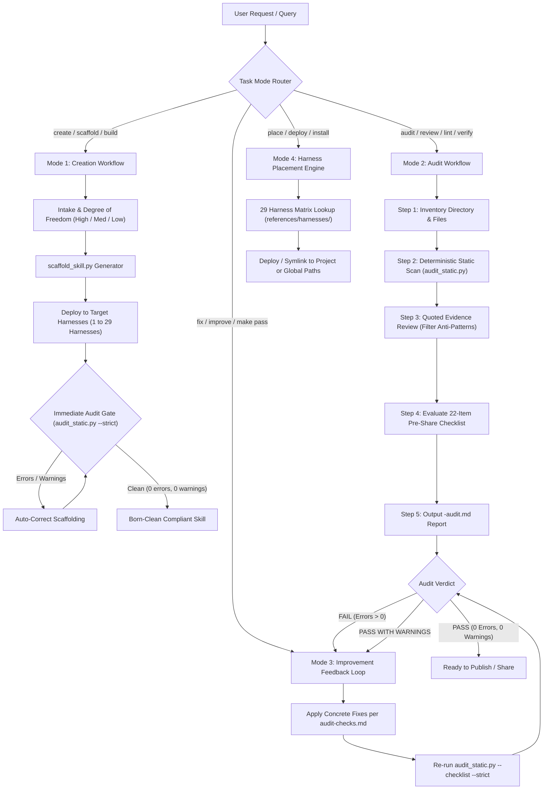

# skill-auditor (`auditing-skills`)

> Deterministic static linter, pre-share checklist evaluator, and audit workflow for agent skills based on [Anthropic's Agent Skills Best Practices](https://platform.claude.com/docs/en/agents-and-tools/agent-skills/best-practices).

Because it is built as a standard `SKILL.md` skill powered by a zero-dependency, Python 3 standard-library linter, it runs identically inside any agent harness (Claude Code, Cursor, Antigravity, ZCode, OpenCode) and in standalone CI/CD environments.

---

## Table of Contents

- [Lifecycle Architecture & Flow Diagram](#lifecycle-architecture--flow-diagram)
- [Are We Missing Anything? The Static vs. Runtime Boundary](#are-we-missing-anything-the-static-vs-runtime-boundary)
- [How to Include Examples in a Skill](#how-to-include-examples-in-a-skill)
- [The Engine of Repeatability](#the-engine-of-repeatability)
- [Master Auditable Fields Matrix (All 45 Checks)](#master-auditable-fields-matrix-all-45-checks)
- [Auditable Areas & The 45-Check Catalog](#auditable-areas--the-45-check-catalog)
- [The 22-Item Pre-Share Checklist](#the-22-item-pre-share-checklist)
- [The 6-Step Repeatable Audit Workflow](#the-6-step-repeatable-audit-workflow)
- [Skill Creation & Scaffolding ("Born Clean")](#skill-creation--scaffolding-born-clean)
- [Cross-Harness Placement Matrix (29 Harnesses)](#cross-harness-placement-matrix-29-harnesses)
- [Plugin & Marketplace Distribution](#plugin--marketplace-distribution)
- [CLI Usage & Filtering](#cli-usage--filtering)
- [CI/CD & Automation](#cicd--automation)
- [Harness Installation](#harness-installation)
- [Repository Layout](#repository-layout)
- [License](#license)

---

## Lifecycle Architecture & Flow Diagram

The complete end-to-end lifecycle connects creation, cross-harness deployment, deterministic static auditing, and continuous verification:



---

## Are We Missing Anything? The Static vs. Runtime Boundary

To answer honestly whether "everything is done and accounted for": **yes — every applicable rule in Anthropic's specification and all 22 items of the Pre-Share Checklist are decomposed into 45 checks across 6 areas, fully cataloged, mapped, and audited.**

Best practices divide into two operational layers:

```
┌─────────────────────────────────────────────────────────────────────────────┐
│ 100% AUTOMATED & DETERMINISTIC (Static Linter: audit_static.py)             │
│ • Frontmatter validation: delimiters, length (≤64/≤1024), character sets   │
│ • Kebab-case naming, directory match, forbidden words (claude, anthropic)  │
│ • 3rd-person grammar, trigger keywords (when, use when), anti-pattern regex │
│ • Structure: SKILL.md < 500 lines, link depth ≤ 1, TOC on files > 100 lines│
│ • Broken relative file links and non-descriptive file names                │
│ • Python AST: bare excepts, missing docstrings, undocumented magic numbers  │
│ • Forward slashes only (flags Windows-style backslashes)                   │
│ • Pre-share checklist evaluation (PASS / FAIL / REVIEW / N/A)               │
└──────────────────────────────────────┬──────────────────────────────────────┘
                                       │
┌──────────────────────────────────────▼──────────────────────────────────────┐
│ RUNTIME & EMPIRICAL EVIDENCE (Agent Judgment / Live Evals)                 │
│ • Live Trigger Rate: Testing whether the model selects the skill among 100+ │
│   unrelated skills requires a live session with metadata loaded.           │
│ • Script Execution Success: The linter verifies AST safety and fallbacks,  │
│   but does NOT execute third-party code (by design, for security).          │
│ • Cross-Model Behavior: verified via recorded results in `evals/evals.json`│
│   (flash-lite / flash-medium / argon-medium ≈ Haiku / Sonnet / Opus tiers) │
└─────────────────────────────────────────────────────────────────────────────┘
```

The static linter guarantees that no structural, syntactic, or obvious procedural defects reach production. The evaluation workflow (`evals/evals.json`) validates the empirical runtime performance.

---

## How to Include Examples in a Skill

Examples are critical for instruction following, but dumping long tutorial code into `SKILL.md` exhausts the context window. Follow these patterns:

### 1. Minimal Quick Start in `SKILL.md` (< 80 lines)
Include one minimal, runnable example using the recommended default tool.
```markdown
## Quick Start

Extract text with `pdfplumber`:
```python
import pdfplumber

with pdfplumber.open("document.pdf") as pdf:
    text = pdf.pages[0].extract_text()
print(text)
```
*Escape hatch*: If processing scanned documents requiring OCR, use `pytesseract` with `pdf2image` instead.
```

### 2. Paired Input / Output Examples (`CQ-04`)
Always pair inputs with the exact expected output structure:
```markdown
Input:
user_request: "Audit git commit message for staged changes"

Output:
feat(parser): add YAML folded block scalar support

- Parse folded block chomping indicators (>, >-, >+)
- Add test coverage in tests/test_frontmatter.py
```

### 3. Strict vs. Flexible Templates (`CQ-04`)
- **Strict Format**: State explicitly: `ALWAYS use this exact template: ...`
- **Flexible Format**: State explicitly: `Use this template as a sensible default; adjust if the user specifies otherwise: ...`

### 4. Progressive Disclosure for Reference Examples (`ST-02`, `ST-03`)
If you have multi-domain examples, edge-case references, or sample payloads:
- Move them to `references/examples.md` or `references/domain.md`.
- Link them directly from `SKILL.md` (1 level deep).
- Include a `## Contents` header if the reference file exceeds 100 lines.

### 5. Clear Anti-Pattern Tagging
When demonstrating what *not* to do, always label the example so the LLM does not adopt the bad pattern:
```markdown
<!-- GOOD: Gerund name, 3rd person, states WHAT + WHEN -->
name: processing-pdfs
description: Extracts text and tables from PDF files. Use when working with PDF files or forms.

<!-- BAD: Uppercase, 1st person, no trigger -->
name: PDF_Helper
description: I can help you process your files.
```

---

## The Engine of Repeatability

How `skill-auditor` guarantees identical, objective results every run:

1. **Deterministic Static AST & Regex Engine**: Standard library `ast`, `re`, `json`, and `pathlib` only. No external packages, no model variance, zero token cost.
2. **Explicit Verification Taxonomy**: Every violation maps to a unique Check ID (`MD-01` to `EV-04`).
3. **The Quoted Evidence Contract**: An agent or human auditor cannot flag an issue without producing:
   - Check ID
   - Severity (`error`, `warning`, `info`)
   - `file:line`
   - Verbatim quote
   - 1-sentence reason
   - 1 concrete fix
4. **Anti-Pattern Exemption**: The linter ignores heuristic matches occurring inside comments or blocks explicitly marked `<!-- BAD -->`, `Avoid:`, or `# BAD`.
5. **Rigid Verdict Formula**:
   - Any `error` $\rightarrow$ **FAIL** (blocks publishing)
   - Zero errors, $\ge 1$ `warning` $\rightarrow$ **PASS WITH WARNINGS**
   - Zero errors and zero warnings $\rightarrow$ **PASS**

---

## Master Auditable Fields Matrix (All 45 Checks)

This master matrix consolidates every auditable field across all 6 areas, defining the exact field inspected, detection method, severity, and verification standard:

| Check ID | Area | Auditable Field / Target | Severity | Method | Deterministic Detection & Verification Criteria |
|---|---|---|---|---|---|
| `MD-01` | MD | `SKILL.md` frontmatter opening | **error** | script | File must exist and open with `---` YAML frontmatter block. |
| `MD-02` | MD | `name` key presence | **error** | script | `name:` field must be present and non-empty. |
| `MD-03` | MD | `name` character length | **error** | script | `len(name) <= 64` characters. |
| `MD-04` | MD | `name` character syntax | **error** | script | Lowercase letters, digits, and hyphens only (`^[a-z0-9]+(?:-[a-z0-9]+)*$`); no XML tags. |
| `MD-05` | MD | `name` reserved identifiers | **error** | script | Must not contain reserved words `claude` or `anthropic`. |
| `MD-06` | MD | `name` directory parity | **error** | script | `name` must strictly match the parent directory name. |
| `MD-07` | MD | `name` grammatical form | **info** | both | Prefers gerund form (`processing-pdfs`) or noun phrase (`pdf-processing`). |
| `MD-08` | MD | `name` semantic specificity | **warning**| both | Rejects generic blacklist: `helper`, `utils`, `tools`, `data`, `files`, `misc`. |
| `MD-09` | MD | `description` key presence | **error** | script | `description:` field must be present and non-empty. |
| `MD-10` | MD | `description` character length| **error** | script | `len(description) <= 1024` characters. |
| `MD-11` | MD | `description` XML markup | **error** | script | Rejects angle brackets / XML tags (`<...>`) in description. |
| `MD-12` | MD | `description` point of view | **warning**| both | Third-person only; flags 1st/2nd person: `\b(i|we|you|your|let's|let me)\b`. |
| `MD-13` | MD | `description` trigger clause | **warning**| both | Must include both WHAT and WHEN (`len >= 40` chars and trigger keywords `when`, `use when`). |
| `MD-14` | MD | `description` specificity | **warning**| both | Rejects vague filler: `helps with`, `does stuff`, `processes data`, `various things`. |
| `MD-15` | MD | `description` keywords | **info** | both | Checks for $\ge 10$ words and concrete domain artifacts (`.xlsx`, `PDF`, `diff`, `json`). |
| `MD-16` | MD | Discovery collision avoidance| **info** | judgment| Ensures description selects cleanly among 100+ skills without intent collisions. |
| `ST-01` | ST | `SKILL.md` body line count | **error** | script | Post-frontmatter body must be under 500 lines (`< 500`). |
| `ST-01a`| ST | `SKILL.md` line early warning | **info** | script | Body $> 400$ lines triggers early-warning to plan file extraction. |
| `ST-02` | ST | Inline code block size | **warning**| both | Code blocks $> 80$ lines or $> 300$-line body with 0 reference files must split into `references/`. |
| `ST-03` | ST | Markdown link graph depth | **warning**| script | References must be **1 level deep** from `SKILL.md` (no `a.md -> b.md` chains; flags orphan files). |
| `ST-04` | ST | Reference Table of Contents | **warning**| script | Markdown files $> 100$ lines must have `## Contents` or $\ge 3$ bullet links in top 80 lines. |
| `ST-05` | ST | File naming conventions | **warning**| script | Rejects non-descriptive names matching `^(doc|file|misc|notes|temp)\d*\.(md|py)`. |
| `ST-06` | ST | Domain reference isolation | **info** | judgment| Multi-domain skills must isolate domains into dedicated reference files. |
| `CQ-01` | CQ | Prose conciseness (~50 tokens)| **warning**| both | Flags textbook definitions: `is a common file format`, `there are many libraries`. |
| `CQ-02` | CQ | Temporal / Date statements | **warning**| both | Flags date expressions (`before 2025`, `currently`) outside `<details>` / `Old patterns`. |
| `CQ-03` | CQ | Terminology consistency | **warning**| both | Detects competing synonyms across markdown files (e.g. `endpoint` vs `route`). |
| `CQ-04` | CQ | Concrete examples & templates| **warning**| both | Verifies presence of code blocks, `Input:`/`Output:` pairs, or explicit templates. |
| `CQ-05` | CQ | Degrees of freedom & options | **info** | both | Flags competing option dumps; requires 1 recommended default + targeted escape hatch. |
| `WF-01` | WF | Sequential step numbering | **warning**| both | Multi-step procedures ($\ge 60$ lines) must use numbered steps (`1.`, `Step 1`). |
| `WF-02` | WF | Progress checklist | **info** | both | Workflows with $\ge 5$ steps must provide a copyable `- [ ]` progress checklist. |
| `WF-03` | WF | Validation feedback loop | **warning**| both | Critical procedures must include a validate $\rightarrow$ fix $\rightarrow$ re-run loop. |
| `WF-04` | WF | Task mode decision points | **info** | both | Distinct task modes (e.g. creating vs editing) must branch at an explicit decision point. |
| `WF-05` | WF | Workflow modularity | **info** | judgment| Complex or long workflows must be moved to dedicated reference files. |
| `SC-01` | SC | Script exception handling | **warning**| both | Python AST analysis: verifies `try/except` around I/O; flags bare `except: pass`. |
| `SC-02` | SC | Magic constant documentation | **info** | both | AST analysis: non-trivial module numeric constants (`TIMEOUT = 30`) must have `#` comment. |
| `SC-03` | SC | Execution intent & docstrings| **warning**| both | Scripts must have module docstrings and explicit `Run scripts/...` vs `Read` documentation. |
| `SC-04` | SC | File path slash format | **error** | script | Forward slashes `/` strictly required; flags Windows backslashes `\`. |
| `SC-05` | SC | Third-party dependencies | **warning**| both | AST: non-stdlib package imports must have install instructions (`pip install`) in docs. |
| `SC-06` | SC | Batch / Destructive safety | **info** | judgment| High-stakes operations must follow plan $\rightarrow$ validate $\rightarrow$ execute. |
| `SC-07` | SC | MCP tool call syntax | **info** | both | MCP tool references must be fully qualified as `ServerName:tool_name`. |
| `SC-08` | SC | Relative path existence | **warning**| script | Every local relative path mentioned in links or backticks must exist on disk. |
| `EV-01` | EV | Evaluation scenarios count | **info** | both | `evals/evals.json` must contain at least 3 scenarios (`query`, `expected_behavior`). |
| `EV-02` | EV | Cross-model testing evidence | **info** | both | Inspects `results[]` in `evals.json` for results recorded across multiple models. |
| `EV-03` | EV | Trigger paraphrase testing | **info** | both | Verifies evaluation suite tests queries that omit the skill's exact keyword name. |
| `EV-04` | EV | Iteration & feedback evidence| **info** | judgment| Notes or docs must demonstrate incorporation of model navigation fixes or user feedback. |

---

## Auditable Areas & The 45-Check Catalog

### Area MD — Metadata (`lint_metadata`)
Startup cost: only `name` and `description` are pre-loaded into the system prompt (~100 tokens/skill).

| ID | Severity | Method | Description |
|---|---|---|---|
| `MD-01` | error | script | `SKILL.md` exists and starts with `---` YAML frontmatter. |
| `MD-02` | error | script | `name` key present and non-empty. |
| `MD-03` | error | script | `name` is $\le 64$ characters. |
| `MD-04` | error | script | `name` contains lowercase letters, digits, and hyphens only (`[a-z0-9-]`); no XML tags. |
| `MD-05` | error | script | `name` does not contain reserved words `claude` or `anthropic`. |
| `MD-06` | error | script | `name` strictly matches the skill directory name. |
| `MD-07` | info | both | `name` uses preferred gerund form (`processing-pdfs`) or noun phrase (`pdf-processing`). |
| `MD-08` | warning | both | `name` is specific (not `helper`, `utils`, `tools`, `data`, `files`). |
| `MD-09` | error | script | `description` key present and non-empty. |
| `MD-10` | error | script | `description` is $\le 1024$ characters. |
| `MD-11` | error | script | No XML tags (`<...>`) in `description`. |
| `MD-12` | warning | both | `description` written in third person (never "I can help", "You can use"). |
| `MD-13` | warning | both | `description` states both **what** the skill does and **when** to use it. |
| `MD-14` | warning | both | `description` is specific (not "Helps with documents", "Processes data"). |
| `MD-15` | info | both | Domain keywords and user artifacts mentioned (`.xlsx`, `PDF forms`, `git diffs`). |
| `MD-16` | info | judgment | `name` and `description` avoid intent collisions across 100+ skills. |

### Area ST — Structure & Progressive Disclosure (`lint_structure`)
`SKILL.md` is an onboarding guide; reference material stays on disk at zero token cost until requested.

| ID | Severity | Method | Description |
|---|---|---|---|
| `ST-01` | error | script | `SKILL.md` body is $< 500$ lines. |
| `ST-01a`| info | script | `SKILL.md` body is $> 400$ lines (approaching limit; plan extraction). |
| `ST-02` | warning | both | Large reference tables or $> 80$-line code blocks extracted into `references/`. |
| `ST-03` | warning | script | Reference files are **1 level deep** (no `SKILL.md -> a.md -> b.md` chains; no unlinked orphan files). |
| `ST-04` | warning | script | Reference files $> 100$ lines include a `## Contents` section near the top. |
| `ST-05` | warning | script | Descriptive filenames used (flags `doc1.md`, `misc.md`, `notes.md`). |
| `ST-06` | info | judgment | Multi-domain skills split references by domain (`finance.md`, `sales.md`). |

### Area CQ — Content Quality (`lint_content`)
The context window is a public good. Assume the model knows common libraries; provide only procedural context.

| ID | Severity | Method | Description |
|---|---|---|---|
| `CQ-01` | warning | both | Concise: no textbook explanations of standard formats/libraries (~50 tokens target). |
| `CQ-02` | warning | both | No time-sensitive statements ("before August 2025"). Legacy notes moved to `<details>` or `## Old patterns`. |
| `CQ-03` | warning | both | Consistent terminology used throughout (no alternating "route" vs "endpoint"). |
| `CQ-04` | warning | both | Concrete `Input:` / `Output:` examples or clear output templates provided. |
| `CQ-05` | info | both | 1 recommended default tool + targeted escape hatch; no option dumps. |

### Area WF — Workflows & Feedback Loops (`lint_workflows`)
Complex tasks require explicit execution sequences and validation loops.

| ID | Severity | Method | Description |
|---|---|---|---|
| `WF-01` | warning | both | Multi-step procedures broken into numbered steps (`1.`, `Step 1`). |
| `WF-02` | info | both | Workflows with $\ge 5$ steps provide a copyable `- [ ]` progress checklist. |
| `WF-03` | warning | both | Validation feedback loop present (`validate -> fix -> re-run before proceeding`). |
| `WF-04` | info | both | Distinct task modes (e.g. creating vs editing) branch at an explicit decision point. |
| `WF-05` | info | judgment | Specialized multi-step workflows moved to dedicated reference files. |

### Area SC — Scripts & Executable Code (`lint_scripts`)
Marked `n/a` for prose-only skills; script checks still scan markdown paths.

| ID | Severity | Method | Description |
|---|---|---|---|
| `SC-01` | warning | both | Scripts handle foreseeable errors (`try/except`) with actionable messages instead of crashing. |
| `SC-02` | info | both | No voodoo constants: configuration constants include a justifying comment. |
| `SC-03` | warning | both | Explicit execution intent documented (`Run scripts/x.py` vs read) + module docstrings. |
| `SC-04` | error | script | Forward slashes only (`/`); no Windows-style backslashes (`\`). |
| `SC-05` | warning | both | Non-stdlib package dependencies listed with install commands (`pip install`). |
| `SC-06` | info | judgment | Batch or destructive operations use plan $\rightarrow$ validate $\rightarrow$ execute. |
| `SC-07` | info | both | MCP tools qualified as `ServerName:tool_name`. |
| `SC-08` | warning | script | Every referenced script, markdown, or asset file exists on disk. |

### Area EV — Evaluation & Testing Evidence (`lint_evaluations`)
Static verification of shipped evaluation scenarios.

| ID | Severity | Method | Description |
|---|---|---|---|
| `EV-01` | info | both | At least 3 evaluation scenarios in `evals/evals.json` (`query`, `files`, `expected_behavior`). |
| `EV-02` | info | both | Testing evidence across model tiers recorded in `results[]`. |
| `EV-03` | info | both | Trigger-paraphrase scenarios included (testing queries without exact skill name). |
| `EV-04` | info | judgment | Evidence of feedback or model navigation fixes incorporated. |

---

## The 22-Item Pre-Share Checklist

Every audit automatically evaluates the official 22-item Pre-Share Checklist:

```markdown
Core Quality (10 items):
- [ ] Description is specific and includes key terms (MD-14, MD-15)
- [ ] Description includes both what the Skill does and when to use it (MD-09, MD-12, MD-13)
- [ ] SKILL.md body is under 500 lines (ST-01)
- [ ] Additional details are in separate files, if needed (ST-02, ST-06)
- [ ] No time-sensitive information, or it lives in an "old patterns" section (CQ-02)
- [ ] Consistent terminology throughout (CQ-03)
- [ ] Examples are concrete, not abstract (CQ-04)
- [ ] File references are one level deep (ST-03)
- [ ] Progressive disclosure used appropriately (ST-02, ST-04, ST-05)
- [ ] Workflows have clear steps (WF-01)

Code and Scripts (8 items):
- [ ] Scripts solve problems rather than defer to Claude (SC-01)
- [ ] Error handling is explicit and helpful (SC-01)
- [ ] No "voodoo constants"; every value is justified (SC-02)
- [ ] Required packages are listed in instructions and verified as available (SC-05)
- [ ] Scripts have clear documentation (SC-03)
- [ ] No Windows-style paths; forward slashes only (SC-04, SC-08)
- [ ] Validation and verification steps for critical operations (SC-06)
- [ ] Feedback loops included for quality-critical tasks (WF-03)

Testing (4 items):
- [ ] At least three evaluations created (EV-01)
- [ ] Tested across model tiers (Haiku, Sonnet, and Opus) (EV-02)
- [ ] Tested with real usage scenarios (EV-03)
- [ ] Team feedback incorporated, if applicable (EV-04)
```

---

## The 6-Step Repeatable Audit Workflow

Copy this checklist when conducting an audit:

```markdown
Audit Progress:
- [ ] Step 1: Inventory directory and all files
- [ ] Step 2: Run static linter (`python3 scripts/audit_static.py <dir> --format markdown`)
- [ ] Step 3: Judge prose quality, workflows, and resolve `needs_review` flags
- [ ] Step 4: Verify the 22-item Pre-Share Checklist
- [ ] Step 5: Compile report using `references/report-template.md`
- [ ] Step 6: (If improving) Apply fixes and re-run with `--strict` until 0 errors remain
```

---

## Skill Creation & Scaffolding ("Born Clean")

Beyond auditing existing skills, `skill-auditor` includes a deterministic scaffolder that generates 100% compliant skills from day one:

```bash
# Scaffold a new skill and place it into your active project harness
python3 auditing-skills/scripts/scaffold_skill.py processing-pdfs \
  --title "PDF Processing" \
  --desc "Extracts text and tables from PDF files. Use when working with PDF documents or forms." \
  --harness claude-code \
  --scope project \
  --freedom medium \
  --with-scripts

# Verify the scaffolder self-test
python3 auditing-skills/scripts/scaffold_skill.py --self-test
```

When using `--dest`, scaffold into a directory whose name matches the skill name — the `name`/directory match is itself audited (`MD-06`).

Every generated skill includes:
1. `SKILL.md` (<100 lines) with gerund naming, 3rd-person description, quick start, paired I/O examples, numbered steps, copyable checklist, and validation loops.
2. `references/reference.md` pre-populated with a `## Contents` table of contents (satisfying `ST-04`).
3. `evals/evals.json` pre-configured with 3 evaluation scenarios (`EV-01`), paraphrase trigger tests (`EV-03`), and multi-model results (`EV-02`).
4. (Optional) `scripts/analyze.py` with docstrings, explicit `try/except`, and commented constants.

---

## Cross-Harness Placement Matrix (29 Harnesses)

`skill-auditor` maintains native discovery rules and directory paths across 29 AI harnesses:

```bash
# List all 29 harnesses and their respective project / global paths
python3 auditing-skills/scripts/scaffold_skill.py --list-harnesses
```

| Harness ID | Target Agent / IDE | Default Project Path | Default Global Path |
|---|---|---|---|
| `claude-code` | Claude Code CLI | `.claude/skills/{name}` | `~/.claude/skills/{name}` |
| `cursor` | Cursor Editor | `.cursor/skills/{name}` | `~/.cursor/skills/{name}` |
| `antigravity` | Google Antigravity & CLI | `.agents/skills/{name}` | `~/.gemini/config/skills/{name}` |
| `opencode` | OpenCode | `.config/opencode/skills/{name}` | `~/.config/opencode/skills/{name}` |
| `zcode` | ZCode Agent | `.agents/skills/{name}` | `~/.agents/skills/{name}` |
| `cline` | Cline Extension | `.cline/skills/{name}` | `~/.cline/skills/{name}` |
| `windsurf` | Windsurf Cascade | `.windsurf/skills/{name}` | `~/.codeium/windsurf/skills/{name}` |
| `gemini-cli` | Gemini CLI | `.gemini/skills/{name}` | `~/.gemini/skills/{name}` |
| `universal` | Standard Universal Agent | `.agents/skills/{name}` | `~/.agents/skills/{name}` |

*(See all 29 detailed guides in [`auditing-skills/references/harnesses/`](auditing-skills/references/harnesses/)).*

---

## Plugin & Marketplace Distribution

This repository includes a root `plugin.json` manifest, allowing `skill-auditor` to be packaged and installed as a unified plugin bundle in modern marketplaces (such as Antigravity, Claude Code, or IDE plugin managers).

```json
{
  "name": "skill-auditor",
  "displayName": "Agent Skill Studio & Auditor",
  "version": "1.0.0",
  "license": "MIT",
  "repository": "https://github.com/whit3rabbit/skill-auditor"
}
```

Installation as an Antigravity Plugin:
```bash
# Symlink or copy to plugin directory
ln -s "$(pwd)" ~/.gemini/config/plugins/skill-auditor
```


---

## CLI Usage & Filtering

```bash
# Standard Markdown report (includes findings + pre-share checklist)
python3 auditing-skills/scripts/audit_static.py /path/to/skill --format markdown

# Text summary with 22-item pre-share checklist
python3 auditing-skills/scripts/audit_static.py /path/to/skill --checklist

# CI mode: exit code 1 on any error finding
python3 auditing-skills/scripts/audit_static.py /path/to/skill --strict

# Filter by area or specific checks
python3 auditing-skills/scripts/audit_static.py /path/to/skill --area MD,ST
python3 auditing-skills/scripts/audit_static.py /path/to/skill --check MD-04,SC-04

# List all 45 checks with severities
python3 auditing-skills/scripts/audit_static.py --list-checks

# Run built-in unit tests and regression checks
python3 auditing-skills/scripts/audit_static.py --self-test
python3 auditing-skills/scripts/frontmatter.py --self-test
```

---

## CI/CD & Automation

### GitHub Actions (`.github/workflows/skill-audit.yml`)
```yaml
name: Agent Skills Audit
on: [push, pull_request]

jobs:
  audit:
    runs-on: ubuntu-latest
    steps:
      - uses: actions/checkout@v4
      - name: Set up Python
        uses: actions/setup-python@v5
        with:
          python-version: "3.11"
      - name: Verify Linters
        run: |
          python3 auditing-skills/scripts/frontmatter.py --self-test
          python3 auditing-skills/scripts/audit_static.py --self-test
          python3 auditing-skills/scripts/scaffold_skill.py --self-test
      - name: Audit Skill
        run: |
          python3 auditing-skills/scripts/audit_static.py auditing-skills --strict
```

### Git Pre-Commit Hook
```bash
#!/bin/sh
python3 auditing-skills/scripts/audit_static.py auditing-skills --strict || exit 1
```

---

## Harness Installation

Install `auditing-skills/` into your environment's skills directory:

| Harness | Path |
|---|---|
| **Claude Code** | `.claude/skills/` (project) or `~/.claude/skills/` (global) |
| **Cursor** | `.cursor/skills/` (project) or `~/.cursor/skills/` (global) |
| **Google Antigravity** | `.agents/skills/` (project) or `~/.gemini/config/skills/` (global) |
| **ZCode** | `.agents/skills/` (project) or `~/.agents/skills/` (global) |
| **OpenCode** | `.config/opencode/skills/` (project) or `~/.config/opencode/skills/` (global) |

---

## Repository Layout

```
skill-auditor/
├── LICENSE                      # MIT license text
├── README.md                    # System architecture, best-practice matrix, and guides
├── AGENTS.md                    # Working rules and verification requirements for agents
├── plugin.json                  # Manifest for plugin marketplace installation
├── auditing-skills/             # The skill itself
│   ├── SKILL.md                 # Progressive disclosure guide, mental model, workflows
│   ├── references/
│   │   ├── audit-checks.md      # 45-check catalog across 6 areas with Good/Bad examples
│   │   ├── pre-share-checklist.md # 22-item official pre-share checklist mapped to checks
│   │   ├── report-template.md   # Verdict rules, severity model, and report format
│   │   └── harnesses/           # 29 harness guides (Claude Code, Cursor, Antigravity, etc.)
│   ├── scripts/
│   │   ├── audit_static.py      # Zero-dependency modular area linter & checklist runner
│   │   ├── scaffold_skill.py    # Compliant skill generator & 29-harness placement manager
│   │   └── frontmatter.py       # Robust YAML frontmatter fallback parser
│   └── evals/
│       ├── README.md            # Execution guide for live evaluations
│       ├── evals.json           # 5 evaluation scenarios + multi-model results log
│       └── fixtures/bad-skill/  # Broken test fixture for regression testing
```

The tree grows over time; generated audit reports (`*-audit.md`) are gitignored.

---

## License

MIT — see [LICENSE](LICENSE).
